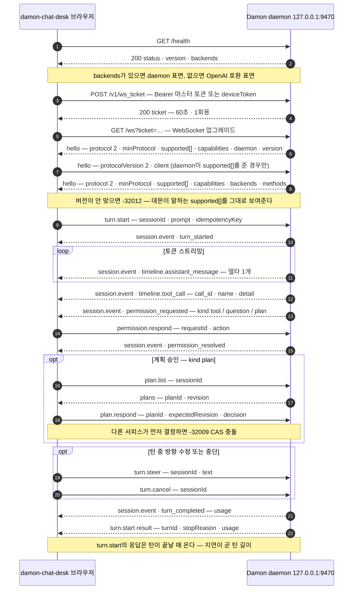
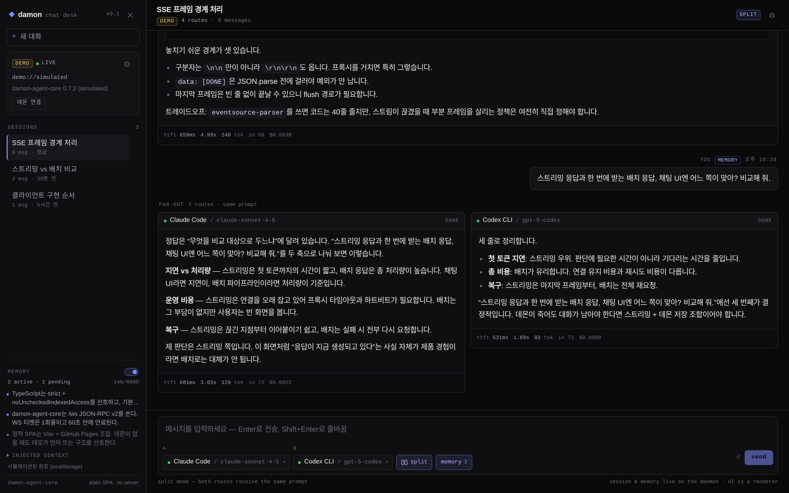
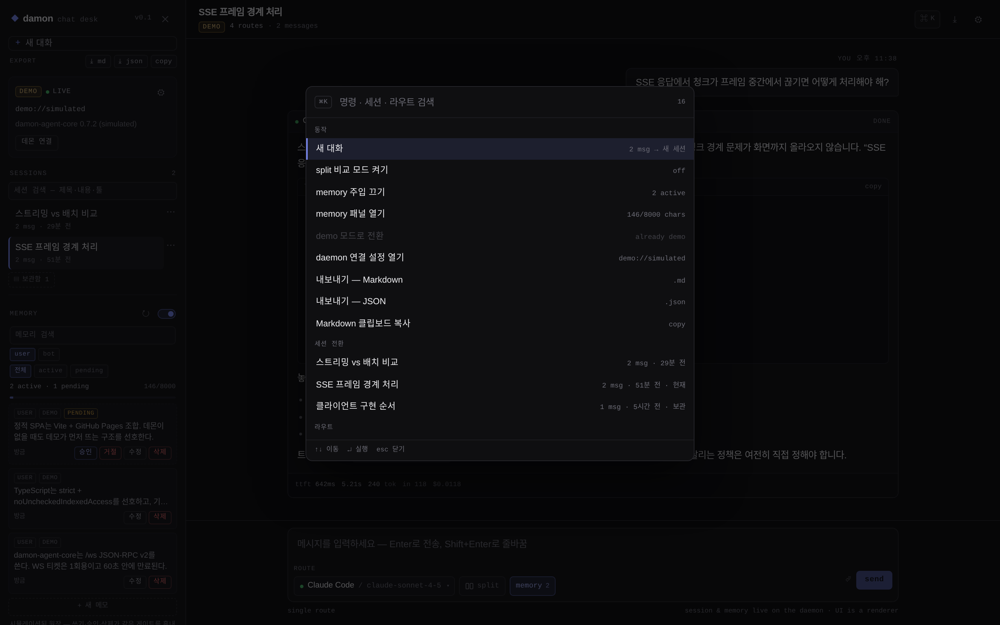
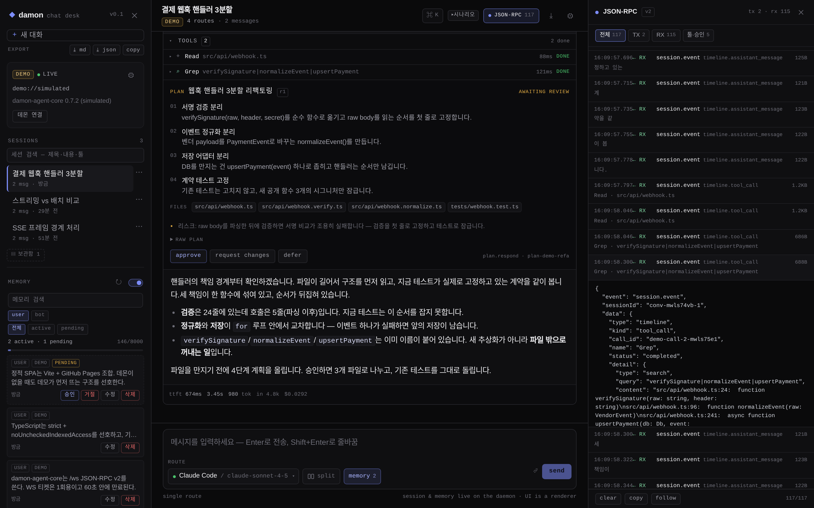
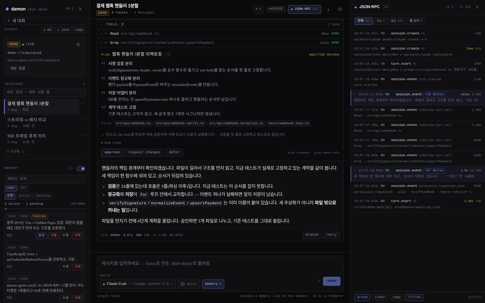
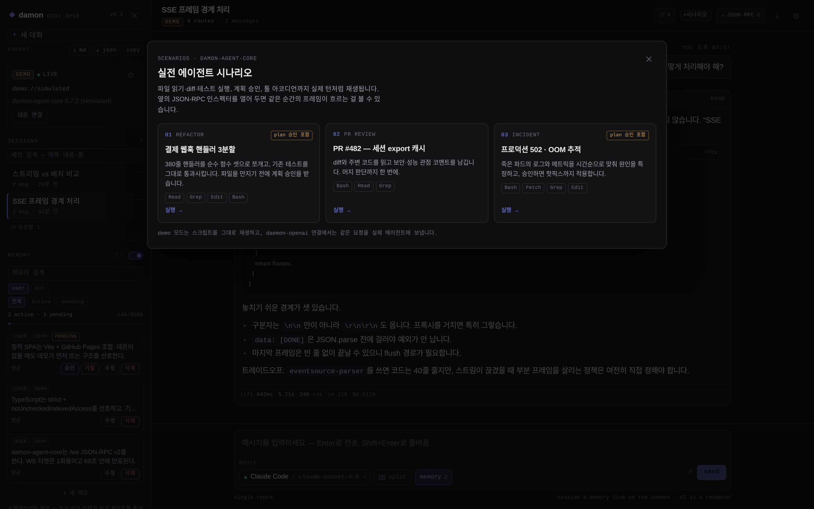
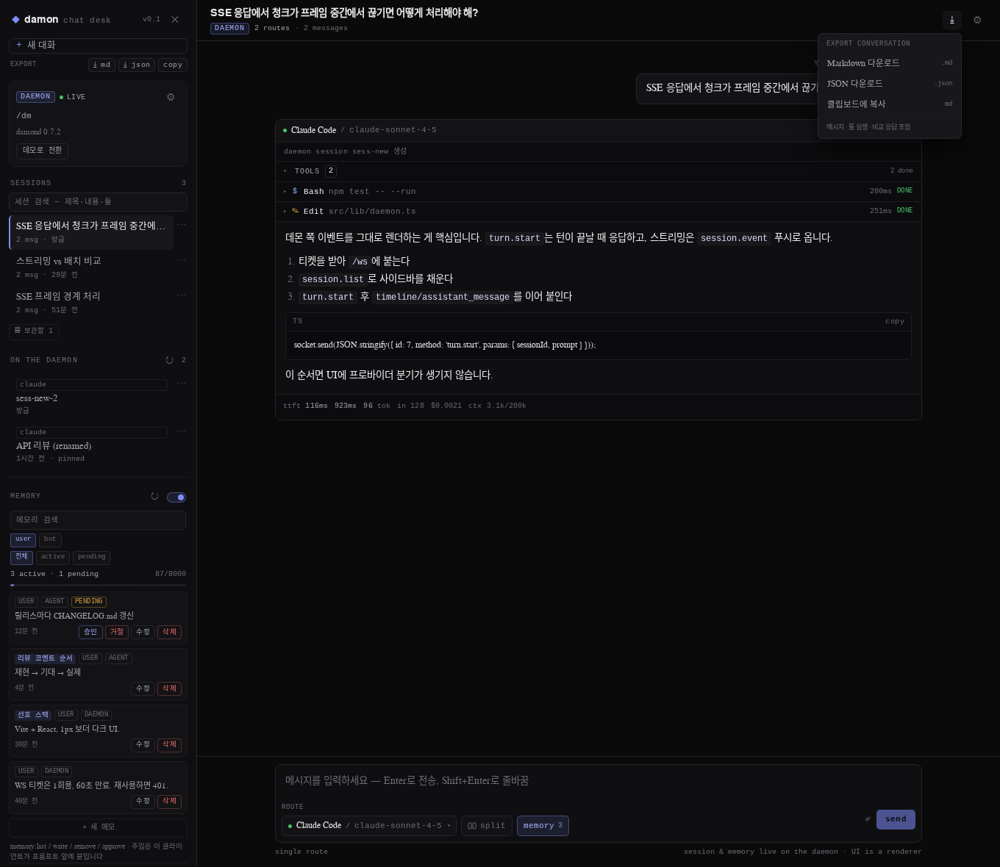
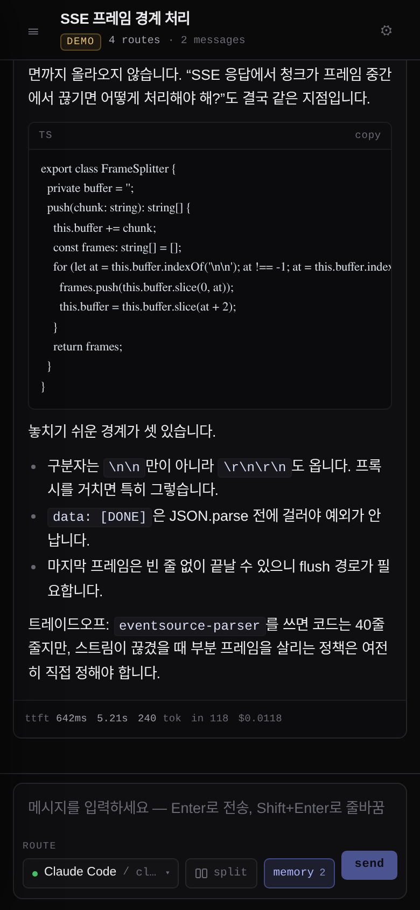

# damon-chat-desk

Damon core의 첫 서피스. 데몬의 단일 API 위에 얹는, 얇은 채팅 클라이언트.

그냥 채팅 UI가 아니다. 프로바이더 라우팅이 눈에 보이는, Damon이라서 되는 채팅 데스크.

## ▶ Live Demo

**[developjik.github.io/damon-chat-desk](https://developjik.github.io/damon-chat-desk/)** — 설치도 키도 없이 브라우저에서 바로. 열면 데모 모드(4개 프로바이더 시뮬레이션)로 대화가 시작된다. 헤더의 `▸ 시나리오`로 실전 시나리오 3종을 1클릭 실행하고, `JSON-RPC` 토글로 그 순간의 프레임을 옆에서 볼 수 있다.

[](https://github.com/developjik/damon-chat-desk/actions/workflows/deploy.yml)


## 구조

```
[damon-chat-desk]  정적 SPA (Vite + React, GitHub Pages)
        |
  단일 API (데몬 HTTP/WS)          ← damon-agent-core: /health, /v1/ws_ticket, /ws(JSON-RPC v2)
        |                            (또는 OpenAI 호환 /v1/models + /v1/chat/completions SSE)
  Damon core (local daemon)         ← github.com/developjik/damon-agent-core
        ├─ provider 어댑터
        ├─ 세션 / 메모리 저장소
        └─ 툴 시스템
```

브라우저가 로컬 데몬을 직접 호출한다. 중간 서버 없음, 서버 비용 0.

### `/ws` 한 턴의 실제 프레임

데몬(`damon-agent-core`)과 이 데스크가 주고받는 순서 그대로다. 왼쪽이 브라우저, 오른쪽이
`127.0.0.1:9470`의 데몬이다. 헤더의 `JSON-RPC` 인스펙터(`⌘I`)를 열어 두면 같은 프레임이
같은 순서로 흐르는 걸 볼 수 있다.



한 턴에 `timeline.assistant_message` 델타가 100개 넘게 쌓이므로, 인스펙터는 **연속된 델타를
한 행으로 접는다**(`← RX session.event ×98 deltas · 2.4s · 11.8KB`). 접힌 행을 누르면 개별 델타
프레임이 펼쳐지고, `group` 토글로 접기를 끌 수 있다. 툴 호출·승인 요청·계획 응답은 접히지 않아
델타 더미에 묻히지 않는다.

## 원칙

1. UI는 얇다. 상태(세션·메모리)는 데몬에, UI는 렌더만.
2. OpenAI 호환 스키마만 말한다. 데몬이 바뀌어도 UI는 안 바뀐다.
3. 로컬 데몬 직접 호출. 브라우저 → localhost. 배포는 정적 파일이면 충분하다.

## 차별 기능 3개

1. **프로바이더 스위처**: 메시지 단위로 모델 변경. 싼 모델로 잡담, 깊은 모델로 결론. 라우팅이 UI에 보인다.
2. **사이드바이드 비교 모드**: 같은 프롬프트를 2개 프로바이더에 동시 발사(fan-out), 나란히 렌더.
3. **데몬 세션/메모리**: 대화 목록과 메모리가 브라우저가 아니라 데몬에 저장된다. 나중에 Telegram·CLI에서 같은 대화를 이어간다. "하나의 코어, 모든 서피스"의 체감 지점.



## 지금 되는 것 (Step 2 MVP + 에이전트 제어 + 세션/메모리 운영 + 커맨드 팔레트 + 인스펙터·시나리오)

- **전송 계층 3개, UI는 하나.** 같은 이벤트로 수렴한다.
  - `daemon` — `damon-agent-core` 실제 표면. `GET /health` → `POST /v1/ws_ticket` → `GET /ws`(JSON-RPC v2). `session.list`/`session.create`/`session.messages`/`session.fork`, `turn.start` + `session.event` 스트리밍, `turn.steer`/`turn.cancel`, `plan.list`/`plan.respond`, `session.rename`/`session.set_archived`/`session.delete`/`session.export`, `memory.list`/`memory.usage`/`memory.write`/`memory.remove`/`memory.approve`/`memory.reject`, `permission.respond`.
  - `openai` — OpenAI 호환 `/v1/models`, `/v1/chat/completions`(SSE). LM Studio·llama.cpp·LiteLLM·게이트웨이.
  - `demo` — 시뮬레이션된 데몬. 네트워크도 키도 없이 GitHub Pages 방문자가 바로 체험. 4개 프로바이더(Claude Code · Codex CLI · Qwen Code · OpenCode)가 서로 다른 속도·말투·단가로 스트리밍하고, 백엔드별 툴 이름(`Bash`/`shell`/`bash`)으로 현실적인 툴 로그와 계획 승인 카드까지 재현한다.
- **프로바이더 스위처**: 응답 카드 헤더에 `프로바이더 / 모델`, 푸터에 TTFT·총 시간·토큰·토큰/초·비용·컨텍스트 사용량.
- **비교 모드**: `split` 칩 → A/B 라우트 선택 → 같은 프롬프트를 동시에. 카드마다 독립 취소·재시도.
- **메모리 원장 CRUD (`memory.*`)**: 사이드바의 메모리 패널이 실제 원장을 읽고 쓴다. `memory.list`로 user 또는 bot(`owner`) 원장을 읽고, 검색어로 좁히고(내용·source·owner), `active`/`pending` 필터와 `chars/limit` 게이지를 보여준다. `memory.write`로 추가, `memory.remove`로 삭제, 수정은 "새 내용 write → 이전 id remove"로 처리하고(원장에 update verb가 없다), 게이트가 붙잡은 `pending` 항목은 `memory.approve`/`memory.reject`로 결정한다. `-32011` 거절은 `error.data.kind`별 문장(`prompt_injection`·`secret`·`invisible`·`capacity`)으로 표시하고, 한도 초과는 실제 숫자(`current/limit`, `+attempted`)를 함께 보여준다. 주입은 user 원장만 프롬프트 앞 `<memory>` 블록으로 붙고, 패널이 bot 원장을 봐도 주입 대상은 바뀌지 않는다.
- **세션 관리 (검색 · 이름 변경 · 보관 · 삭제)**: 사이드바 검색창이 제목·메시지 본문·툴 라벨·세션 id까지 실시간으로 필터한다(로컬 대화와 데몬 세션 목록에 같은 질의). 각 행의 `⋯` 메뉴에서 `session.rename`(이름 변경), `session.set_archived`(보관 — 목록에서 숨기고 기록 유지, `보관함 N` 토글로 다시 보기), `session.delete`(2단계 확인 후 삭제)를 호출한다. 데몬이 해당 verb를 모르면 `-32601`을 받아 "이 화면에만 반영" 폴백으로 처리하고 그 사실을 알린다. 데모 모드도 같은 조작을 시뮬레이션 원장에 반영한다.
- **대화 내보내기 (Markdown / JSON)**: 헤더의 `⤓` 메뉴 또는 사이드바의 `md · json · copy`로 현재 대화를 파일로 내려받거나 클립보드에 복사한다. 내보내는 것은 화면에 보이는 그대로 — 메시지, 비교 모드의 두 응답, 툴 호출 표(이름·인자·상태·소요·exit)와 stdout/stderr/diff 블록, 턴 중 방향 수정, 계획서, 토큰·비용 합계, 주입된 메모리 원장이다. Markdown은 읽기용(코드 펜스는 내용의 백틱보다 길게), JSON은 `damon-chat-desk.conversation.v1` 스키마로 기계가 다시 읽을 수 있게 쓴다.
- **커맨드 팔레트 (`⌘K` / `Ctrl+K`)**: 헤더의 `⌘K` 칩이나 키보드로 열면 된다. 새 대화, 세션 전환, `split` 비교 모드 토글, `memory` 주입 토글·패널 열기, `demo`/`daemon` 전환, Markdown·JSON 내보내기, A/B 라우트 선택을 한 입력창에서 검색해 실행한다(방향키·Enter·Esc). 비활성 행은 건너뛰고, 검색어의 모든 토큰이 label·detail·keyword에 걸려야 남는다.
- **턴 중단 (`turn.cancel`)**: 스트리밍 중 카드의 `stop`, 헤더의 `■ stop`, 또는 `Esc`로 중단한다. 데몬·데모 모두 중단 즉시 카드가 `canceled`로 바뀌고 **그때까지의 부분 응답은 그대로 남는다** — `error`로 튀지 않고, 다시 `retry`하거나 그 턴에서 `branch`할 수 있다. 비교 모드에서는 카드 단위로만 멈춘다.
- **정적 호스팅 안전장치**: https 공개 페이지(GitHub Pages)에서는 브라우저가 `http://127.0.0.1` 데몬에 붙을 수 없다(혼합 콘텐츠·사설망 차단). 그런 페이지에 loopback 데몬 설정이 남아 있으면 `offline` 화면 대신 데모 모드로 시작하고, 연결 패널이 그 이유를 설명한다. `base`는 `VITE_BASE_PATH`로 주입한다(기본 `/`, Pages는 `/damon-chat-desk/`).
- **툴 결과 뷰어**: `timeline/tool_call`을 `call_id`로 접어 한 호출 = 한 행으로 만든다. 행은 `Bash · npm test --run · 1.28s · done`처럼 접혀 있고, 펼치면 인자·stdout/stderr·unified diff(+/− 거터)·exit code·소요 시간이 보인다. 데몬의 `ToolCallDetail`(shell·read·edit·write·search·fetch·sub_agent)을 그대로 정규화하며, 실행 중인 호출은 펄스로 남는다.
- **스트리밍 중 `turn.steer`**: 응답이 흐르는 동안 입력창이 `send` → `steer`로 바뀐다. 보낸 문장은 새 턴을 열지 않고 진행 중인 턴으로 들어가며, 카드에 `↳ 방향 수정 …` 행으로 남는다. 데몬이 `-32002`(백엔드 미지원)로 거절하면 그 사실이 행에 표시되고 다음 메시지로 넘긴다.
- **계획 승인 카드 (`plan.respond`)**: `kind: plan` 승인 요청(Claude의 ExitPlanMode)은 계획 원문을 구조화해 단계·변경 파일·리스크로 보여준다. `approve`/`request changes`/`defer` 세 갈래로 응답하고, 수정 요청은 문장이 deny 메시지로 그대로 전달된다. `plan.list`로 얻은 `planId`+`revision`(CAS)으로 보내므로 다른 서피스가 먼저 결정하면 `-32009` 충돌을 카드에 표시한다. `permission_resolved`가 오면 카드는 더 이상 답할 수 없는 상태로 닫힌다.
- **턴 단위 분기 (`session.fork`)**: 답변 카드의 `branch` 버튼이 그 턴까지의 대화를 새 세션으로 복사하고, 데스크는 그 복사본을 새 대화로 연다(제목 `… (fork)`, 상단 `branch` 배지). 원본 세션은 그대로 이어간다.
- **승인 카드**: 데몬이 `permission_requested`를 보내면 카드에 액션 버튼이 뜨고 `permission.respond`로 응답한다.
- **실시간 JSON-RPC 인스펙터 (`⌘I` / `Ctrl+I`)**: 헤더의 `JSON-RPC` 토글(프레임 수 배지)로 우측 드로어를 연다. 데모·데몬(`/ws`)·OpenAI 모드에서 실제로 오간 프레임을 타임스탬프·방향(`→ TX` / `← RX`)·메서드·지연(ms)·크기와 함께 스트리밍으로 보여준다 — `turn.start` 요청과 응답(턴이 끝날 때 응답하므로 지연이 곧 턴 길이), `session.event` 푸시(`timeline.assistant_message`·`tool_call`·`permission_requested`), `turn.steer`, `turn.cancel`, `session.fork`, `plan.respond`, OpenAI 모드의 `POST /v1/chat/completions` + SSE 청크까지. **연속된 텍스트 델타는 한 행으로 접힌다** — `← RX session.event ×98 deltas · 2.4s · 11.8KB`처럼 개수·경과 시간·바이트를 붙여 한 줄로 묶고, 누르면 개별 델타 프레임이 펼쳐진다. 툴 호출·승인 요청·계획 응답 같은 프레임이 끼면 접힘이 끊기므로 핵심 프레임이 델타 더미에 묻히지 않고, `group` 토글로 접기를 끄면 예전처럼 프레임 1개 = 행 1개다. 행을 누르면 페이로드 JSON이 펼쳐지고, `전체 / TX / RX / 툴·승인` 필터·`group`·`clear`·`copy`(프레임 전체를 JSON 블록으로)·`follow`(자동 스크롤)를 제공한다. 데몬 모드에서는 `RpcClient`가, 데모에서는 시뮬레이터가 같은 봉투를 탭에 기록하므로 **데모와 실 데몬의 프레임이 같은 화면에서 비교된다**.
- **실전 에이전트 시나리오 3종**: 헤더 `▸ 시나리오`(또는 커맨드 팔레트)에서 1클릭으로 실행한다. ① **코드 리팩토링** — 380줄 웹훅 핸들러를 `Read`/`Grep`으로 진단하고 계획 카드를 띄운 뒤, 승인하면 `Edit`/`Write`와 `npm test`·`tsc`까지 이어서 실행한다. ② **PR 리뷰** — PR diff·라우트·캐시 구현을 읽고 보안(P1 텐넌트 스코프 누락)·성능·정합성 코멘트와 머지 판단을 남긴다. ③ **장애 분석** — OOMKilled 파드 로그·이벤트·Grafana 메트릭을 시간순으로 맞춰 502의 원인을 특정하고, 승인하면 큐 상한·본문 제한 핫픽스를 적용한다. 각 실행은 데모에서 스크립트를 재생하고(툴 아코디언·계획 카드·`turn.steer` 포함), 데몬·OpenAI 연결에서는 같은 프롬프트를 실제 에이전트에 보낸다.
- **세션 상태 (`session.status`)** — 사이드바의 모든 세션 행과 헤더가 그 세션이 **지금 무엇을 하는지** 보여준다: `busy`(턴 실행 중) / `waiting`(사용자 답을 기다림, `plan`·`permission`·`question` kind와 라벨까지). 같은 세션이 이 창에서 스트리밍 중이면 폴링을 기다리지 않고 슬롯에서 바로 읽고(`source: local`), 다른 서피스가 돌리는 턴은 데몬 원장이 알려준다. 이전 데몬이 **턴 도중 죽어 남긴 세션**은 본문 위 `RECOVERED` 배너로 알리고(세션 id·백엔드·"턴 실행 중이던 · 9분 전"), `이어받기`(`session.resume`)를 누르면 즉시 사라진다. `capabilities.sessionPhase`가 없는 구버전 데몬에는 이 호출을 아예 보내지 않고, 그래도 이 창이 돌리는 턴은 칩으로 보인다. [자세히](docs/protocol-v2-adoption.md#세션-상태-sessionstatus)
- **프로토콜 v2 계약 채택 (전달 정직성 · 멱등 턴)**: 데몬 `hello`의 `minProtocol`·`supported[]`·`capabilities`로 **버전을 협상**하고(`-32012`면 데몬이 말하는 버전을 밝히고 연결을 거부), 연결 카드에 `protocol v2 · 7/7 capabilities`를 적는다. 턴 스트림은 이벤트 커서(`seq`)를 접어 **끊긴 번호를 직접 세고**, `session.gap`·`session.snapshot_required`를 카드 헤더 아래 경고줄로 올린다 — 저널이 잘린 턴은 끝난 뒤 `session.messages`로 다시 읽어 저장본이 더 길 때만 본문을 채운다(`resynced`/`stale`). `turn.start`/`turn.steer`에는 턴 키(`idempotencyKey`)를 붙여, 전송 실패로 끝난 재시도는 같은 키로 재생하고(`{duplicate}`), 이미 다른 연결이 시작한 턴이면 `{duplicate, inProgress}`를 받아 **새 턴을 만들지 않고 그 스트림을 계속 읽는다**. `-32001`(죽은 세션)은 `session.resume` 후 같은 키로 1회 복구한다. 자세히: [`docs/protocol-v2-adoption.md`](docs/protocol-v2-adoption.md).
- 단위 테스트 350개(세션 위상 정규화·병합·복구 배너·구버전 데몬 하위 호환·칩 렌더·SSE 파서·OpenAI 스트림 매핑·JSON-RPC 클라이언트·버전 협상·전달 커서/갭 추적·데몬 이벤트 매핑·키드 턴 스트림·툴 정규화·계획 파싱·데모 시뮬레이터·라우팅/포맷·마크다운 렌더·툴 뷰어/계획 카드·메모리 필터/게이트 오류·세션 검색·내보내기 빌더·커맨드 카탈로그/검색/커서·정적 호스팅 판정·턴 중단·컨트롤러·와이어 탭/프레임 필터·델타 그룹핑·시나리오 스크립트·시나리오 실행·계획 승인 후속 실행·인스펙터 렌더·turn.cancel/session.fork 프레임).













## 실행

Node 22와 `npm`만 있으면 된다(런타임 의존성은 react/react-dom 둘뿐).

### 1. 클라이언트

```bash
git clone https://github.com/developjik/damon-chat-desk.git
cd damon-chat-desk
npm ci             # lockfile 그대로 설치
npm run dev        # http://127.0.0.1:5173/  (base 기본값 /)
```

| 명령 | 결과 |
| --- | --- |
| `npm run dev` | 개발 서버 + `/dm` 프록시(아래) |
| `npm test` | vitest 전 시나리오 350개 |
| `npm run test:bombadil` | Bombadil UI 불변식 — 배포된 데모를 3분간 무작위로 조작하며 명세를 검사(아래) |
| `npm run typecheck` | `tsc` 타입 검사만 |
| `npm run typecheck:bombadil` | `bombadil/desk.spec.ts` 명세의 타입만 |
| `npm run build` | `dist/` (base `/`) — 자동 배포는 `VITE_BASE_PATH=/damon-chat-desk/ npm run build` |
| `npm run preview` | 빌드 결과를 4173에서 확인 |

base 경로는 `VITE_BASE_PATH` 하나로 정한다: 개발·프리뷰는 `/`, GitHub Pages 프로젝트 페이지는
`/damon-chat-desk/`. 같은 명령에 환경변수만 다르게 주면 asset URL이 그에 맞게 나온다(워크플로는
[`.github/workflows/deploy.yml`](.github/workflows/deploy.yml)이 같은 값을 넘겨 빌드한다).

### 2. 데몬에 붙이기 (실제 JSON-RPC v2)

데몬은 기본적으로 `127.0.0.1:9470`에 바인드한다. 터미널 두 개가 편하다.

```bash
# 터미널 1 — 데몬 (백엔드 CLI는 각자 로그인)
damond                                     # GET /health · POST /v1/ws_ticket · GET /ws

# 터미널 2 — 데스크
npm run dev                                # http://127.0.0.1:5173/
```

데스크 화면에서 **설정(⚙) → Damon daemon → `로컬 프록시 /dm`** 를 누른다. `npm run dev`가 여는
`/dm` 프록시가 `http://127.0.0.1:9470`으로 넘긴다 — 브라우저 입장에서는 같은 오리진이라
CORS·혼합 콘텐츠에 걸리지 않는다.

1. 데모 모드로 열린 화면에서 ⚙를 열고 `Damon daemon` 탭으로 간다.
2. `로컬 프록시 /dm` 버튼을 누른다(데몬에 마스터 토큰을 걸었다면 입력창에 먼저 넣는다).
3. 헤더에 데몬 버전·백엔드가 뜨면 연결된 것 — 사이드바에 데몬 세션 목록과 메모리 원장이 채워진다.
4. `⌘I`로 인스펙터를 열고 메시지를 보내면 `hello` → `turn.start` → `session.event`가 실제로 흐른다.


**왜 프록시인가**: 데몬은 CORS 헤더를 보내지 않는다(자기 UI를 `/ui`로 직접 서빙하는 설계).
다른 오리진의 페이지에서 `fetch`로 직접 부르면 브라우저가 막는다. 그래서
- 개발/프리뷰에서는 `/dm` 프록시로 **같은 오리진**을 만든다(WebSocket도 같은 경로로 프록시된다),
- 배포된 GitHub Pages 빌드에서는 **demo 모드로 먼저 체험**하고,
- 원격 데몬은 페어링(`POST /v1/pair` → 승인 → `deviceToken`) 후 같은 오리진 경로로 붙인다.
  페어링 흐름은 설정 패널에 구현되어 있다(8자리 `device.pairing_key` → `pair` → `pair/status` 확인 → 토큰 저장).

### 3. OpenAI 호환 서버에 붙이기

```bash
# LM Studio(1234), llama.cpp(8080) 등 — CORS를 허용하는 서버
```
설정 → **OpenAI 호환** → base URL 입력. 모델 목록은 `/v1/models`에서 가져와 벤더별로 묶는다.

## 배포

**`main`에 푸시하면 GitHub Actions가 테스트·빌드·배포까지 돌고, 결과가
<https://developjik.github.io/damon-chat-desk/> 에 올라간다.** 워크플로는
[`.github/workflows/deploy.yml`](.github/workflows/deploy.yml) 하나이고, `push`(main)와 수동 실행
(`workflow_dispatch`)을 받는다. 실행 기록은 [Actions 탭](https://github.com/developjik/damon-chat-desk/actions/workflows/deploy.yml)에서 본다.

- Settings → Pages → Source는 **GitHub Actions**로 지정되어 있다(`build_type: workflow`). `gh-pages` 브랜치는 쓰지 않는다.
- 단계: `npm ci` → `npm test`(350개) → `npm run build` → `upload-pages-artifact` → `deploy-pages`. 테스트가 깨지면 배포도 나가지 않는다.
- 빌드 단계가 `VITE_BASE_PATH=/damon-chat-desk/`를 넘긴다. 이 값이 없으면 asset이 `/assets/…`로 나가 프로젝트 페이지에서 404가 된다.
- 산출물은 `dist/` 정적 파일뿐이고, 중간 서버도 서버 비용도 없다.

Pages와 같은 빌드를 로컬에서 확인하려면:

```bash
VITE_BASE_PATH=/damon-chat-desk/ npm run build
VITE_BASE_PATH=/damon-chat-desk/ npm run preview   # http://127.0.0.1:4173/damon-chat-desk/
```

수동 배포가 필요하면 `workflow_dispatch`로 같은 워크플로를 한 번 돌리면 된다(`dist/`를 직접 올릴 일은 없다).

### 테스트 CI (PR)

[`.github/workflows/ci.yml`](.github/workflows/ci.yml)이 PR 단계에서 먼저 막는다. Node 22에서
`npm ci` → `npx tsc --noEmit` → `npm test` → `npm run build` →
`VITE_BASE_PATH=/damon-chat-desk/ npm run build`를 돌려, `deploy.yml`이 `main` 푸시에서 다시 돌릴
검사를 머지 전에 본다. 트리거는 `pull_request`·`push`(main)·`workflow_dispatch`이고, 같은 브랜치에
새 커밋이 오면 이전 실행은 취소된다. 각 단계의 의미는 [`docs/ci-setup.md`](docs/ci-setup.md)에 있다.

워크플로 사본은 `docs/`에 둔다 — [`docs/ci.workflow.yml`](docs/ci.workflow.yml)은 `ci.yml`의,
[`docs/deploy.workflow.yml`](docs/deploy.workflow.yml)은 `deploy.yml`의 참고용 사본이다(실제로 도는 파일은
`.github/workflows/` 아래이고, 고칠 때는 원본과 사본을 같이 고친다). `.github/workflows/` 경로는 푸시
주체에 `workflows` 스코프가 없으면 거부되므로, 이 두 워크플로도 웹 에디터로 올렸고 이후 수정도 그
권한이 있는 계정이나 웹 에디터로 한다.

### UI 불변식 (Bombadil)

예시를 고정해 두는 vitest와 달리, [Bombadil](https://github.com/antithesishq/bombadil)은 명세가 말한
**성질**을 지키는지 화면을 무작위로 조작하며 본다 — 클릭·스크롤·뒤로가기, 그리고 이 데스크가 문서에
내건 단축키(⌘K · ⌘I · Esc)와 턴 전송을 스스로 굴려 간다. 명세는
[`bombadil/desk.spec.ts`](bombadil/desk.spec.ts) 하나다.

기본 속성은 Bombadil의 기본값을 그대로 쓴다 — 콘솔 에러·미처리 예외·미처리 프로미스 거부·HTTP
4xx/5xx가 없다. 그 위에 이 화면의 불변식을 더한다.

| 속성 | 보는 것 |
| --- | --- |
| `singleModalAtATime` | 팔레트·연결 설정·시나리오 런처는 `aria-modal` 다이얼로그다. 동시에 둘이 열려 있으면 안 된다 |
| `modalsAreNamed` | 보이는 모든 다이얼로그는 `aria-modal`이고 자기 이름(`aria-label`)을 갖는다 |
| `busyMirrorsStopControl` | 스토어의 `busy`와 상단의 `■ stop` 버튼이 같이 움직인다 |
| `inspectorMirrorsDrawer` | `inspector.open` · 실제 드로어 · 토글의 `aria-pressed`가 서로 맞는다 |
| `transcriptMirrorsActiveConversation` | 화면의 턴 수가 활성 대화의 메시지 수와 같다 — 보낸 턴이 빠지거나 유령 턴이 남지 않는다 |
| `transportChipMatchesStore` | 헤더의 `demo`/`daemon`/`openai` 칩이 실제 연결과 같다 |
| `headerNamesTheConversation` | 헤더는 항상 열린 대화를 말한다(`새 대화` 포함) |
| `singleComposer` | 컴포저는 정확히 하나만 마운트된다 |
| `liveTurnSettles` | 살아 있는 턴은 45초 안에 끝난다 — 스트림이 멈춘 채 남으면 실패 |

스토어는 `src/main.tsx`가 e2e용으로 노출하는 `window.__damonDesk`에서 읽고, 없으면 순수 DOM만으로
검사한다. 그래서 배포된 Pages 데모에도, 로컬 빌드에도 같은 명세를 쓸 수 있다.

```bash
npm run test:bombadil                       # 배포된 Pages 데모(데모 모드)를 3분
BOMBADIL_TIME_LIMIT=30s npm run test:bombadil

# 이 작업 트리의 빌드로 돌리려면 (CI가 하는 것과 같은 경로)
npm run build && npm run preview &          # http://127.0.0.1:4173/
BOMBADIL_ORIGIN=http://127.0.0.1:4173/ npm run test:bombadil

# 실패했을 때 그 상태를 되짚기
npx bombadil browser inspect bombadil-output
```

CLI는 `@antithesishq/bombadil` devDependency에 들어 있고(Linux x64/arm64 · macOS arm64), Chrome은
`CHROME` 환경변수로 지정하거나 PATH에 있으면 된다. `--no-sandbox`는 CI/컨테이너처럼 user namespace가
막힌 곳에서 필요해서 스크립트에 넣어 두었다.

[`.github/workflows/bombadil.yml`](.github/workflows/bombadil.yml)이 PR마다 같은 검사를 돌린다:
`npx tsc -p bombadil --noEmit` → `npm run build` → `npm run preview`(백그라운드) →
`antithesishq/bombadil-action@v3`로 5분 실행. 배포된 Pages가 아니라 **그 PR의 빌드**를 검사하고,
위반이 있으면 `bombadil-trace` 아티팩트를 남긴다. 사본은
[`docs/bombadil.workflow.yml`](docs/bombadil.workflow.yml)이다.

## 검증 도구

실제 데몬/백엔드 없이 전송 계층을 확인할 수 있는 목 서버 두 개를 넣어 두었다(Python + aiohttp).

```bash
python3 tools/mock-daemon.py     # :9470 — /health, /v1/ws_ticket, /v1/pair, /ws(JSON-RPC v2)
python3 tools/mock-openai.py     # :1234 — /v1/models, /v1/chat/completions(SSE, CORS 허용)
```

`mock-daemon.py`는 실제 프로토콜 프레임을 그대로 흉내낸다: `hello`, `session.list`,
`session.create`, `session.messages`, `session.fork`, `catalog.models`, `memory.list`/`memory.usage`,
`turn.start` 이후의 `session.event` 델타·툴 호출(셸 출력·diff)·`turn_completed`(usage),
`turn.steer`, 그리고 `kind: plan` 승인 요청 → `plan.list` → `plan.respond`(승인 전까지 턴이 멈춰 있는다)
까지다. 데스크를 `/dm`으로 연결하면 툴 아코디언·스티어·계획 카드·분기를 실제 경로로 확인된다.

## 메모리 주입에 대해

이 클라이언트의 `memory` 토글은 **클라이언트 쪽 주입**이다: 켜면 `memory.list`의 active 항목을
`<memory>` 블록으로 만들어 프롬프트 앞에 붙이고, 붙는 그대로를 사이드바 `injected context`에서 보여준다.
데몬 설정의 `[memory]`가 켜져 있으면 데몬도 자기 원장을 주입하므로, 중복을 피하려면 한쪽만 켜면 된다.

## 데몬 표면과의 정렬

이 클라이언트는 `damon-agent-core` **v0.8.0**(`Cargo.toml` `version = "0.8.0"`, 릴리스 `v0.8.0`)의 실제 구현을 기준으로 맞췄다(`src/api.rs`, `docs/protocol-v2.md`).

| 표면 | 쓰임 |
| --- | --- |
| `GET /health` | 프로브. `{status, version, backends[]}` (non-loopback은 roster를 숨긴다) |
| `POST /v1/ws_ticket` | 마스터 `Authorization: Bearer` 또는 `{deviceToken}` → 1회용 티켓(60s) |
| `GET /ws?ticket=…` | JSON-RPC v2. `hello` → `session.*` / `turn.*` / `memory.*` / `catalog.models` |
| `POST /v1/pair`, `/v1/pair/status` | 기기 페어링(pending → approved → revoked) |
| `session.event` 푸시 | `turn_started`, `timeline`(assistant_message·tool_call[detail]), `turn_completed`(usage), `turn_failed`, `permission_requested`(tool·question·**plan**), `permission_resolved` |
| `hello` (요청) | `{protocolVersion, client}` → `minProtocol`·`supported[]`·`capabilities`. `-32012`는 `data.supported[]`와 함께 연결 거부 |
| `session.gap` / `session.snapshot_required` | 이 연결이 놓친 이벤트 수 / 저널이 잘린 턴 — 카드 경고줄 + `session.messages` 재동기화 |
| `turn.start` · `turn.steer`의 `idempotencyKey` | 같은 키의 재전송은 `{duplicate}`(또는 `{duplicate, inProgress}`)로 재생 — 중복 턴 없이 재시도 |
| `turn.steer` / `turn.cancel` | 진행 중인 턴에 방향 수정을 주입 / 취소 |
| `session.fork` | 세션 복사(메시지·태그·usage·resume handle) → 새 `sessionId` |
| `plan.list` / `plan.respond` | 계획 리뷰 리비전 목록 / `expectedRevision` CAS 승인·수정요청·보류 (`-32009` 충돌) |
| `session.status` | 라이브 세션별 `phase`·`turnId?`·`pendingAsk?` + 이전 데몬이 턴 도중 남긴 `recovered[]` — 행 칩과 복구 배너 |

주의: 업스트림에서 OpenAI 호환 `/v1/chat/completions`·`/v1/models`는 **제거**되었다(에이전트가 답하는 구조로 전환).
그래서 데스크는 `/health`의 응답 모양으로 표면을 판별하고(`backends[]` → daemon, 아니면 `/v1/models` → openai),
두 경우 모두 같은 UI 이벤트로 정규화한다. 위 README의 "OpenAI 호환 스키마만 말한다" 원칙은
*UI 계약*으로 유지되고, 데몬 연동은 데몬의 실제 프로토콜을 따른다.

## 스택

- Vite 6 + React 19 + TypeScript (strict)
- 의존성은 react/react-dom 뿐. 마크다운 렌더러·SSE 파서·JSON-RPC 클라이언트·데모 시뮬레이터는 직접 구현
- 다크 터미널 미학 (JetBrains Mono 계열 모노스페이스, 1px 보더, 고밀도 데이터 뷰)
- 1440px 데스크톱 / 390px 모바일 모두 동작 (사이드바 드로어, 비교 모드 세로 스택)



## 게이트 확정 (이 레포가 증명하는 것)

- Damon 첫 서피스 = 웹 (이 레포)
- provider 층위 = LLM API 수준 (채팅은 harness 없이 순수 LLM API)
- 데몬 표면은 바뀌어도 UI 계약은 유지된다 — 실제로 업스트림 `/v1` 제거를 흡수했다
