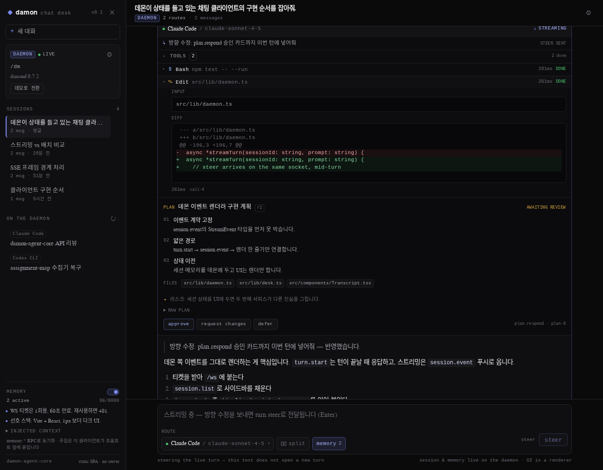
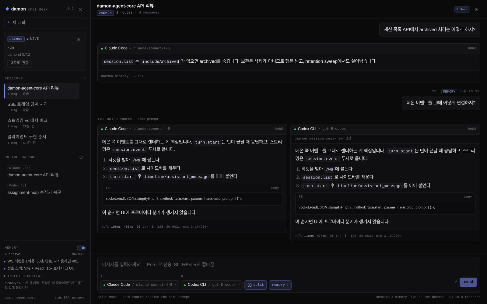

# damon-chat-desk

Damon core의 첫 서피스. 데몬의 단일 API 위에 얹는, 얇은 채팅 클라이언트.

그냥 채팅 UI가 아니다. 프로바이더 라우팅이 눈에 보이는, Damon이라서 되는 채팅 데스크.


## 구조

```
[damon-chat-desk]  정적 SPA (Vite + React, GitHub Pages)
        |
  단일 API (데몬 HTTP/WS)          ← damon-agent-core: /health, /v1/ws_ticket, /ws(JSON-RPC v2)
        |                            (또는 OpenAI 호환 /v1/models + /v1/chat/completions SSE)
  Damon core (local daemon)         ← github.com/developjik/damon-agent-core
        ├─ provider 어댑터
        ├─ 세션 / 메모리 저장소
        └─ 툴 시스템
```

브라우저가 로컬 데몬을 직접 호출한다. 중간 서버 없음, 서버 비용 0.

## 원칙

1. UI는 얇다. 상태(세션·메모리)는 데몬에, UI는 렌더만.
2. OpenAI 호환 스키마만 말한다. 데몬이 바뀌어도 UI는 안 바뀐다.
3. 로컬 데몬 직접 호출. 브라우저 → localhost. 배포는 정적 파일이면 충분하다.

## 차별 기능 3개

1. **프로바이더 스위처**: 메시지 단위로 모델 변경. 싼 모델로 잡담, 깊은 모델로 결론. 라우팅이 UI에 보인다.
2. **사이드바이드 비교 모드**: 같은 프롬프트를 2개 프로바이더에 동시 발사(fan-out), 나란히 렌더.
3. **데몬 세션/메모리**: 대화 목록과 메모리가 브라우저가 아니라 데몬에 저장된다. 나중에 Telegram·CLI에서 같은 대화를 이어간다. "하나의 코어, 모든 서피스"의 체감 지점.


## 지금 되는 것 (Step 2 MVP + 에이전트 제어 + 세션/메모리 운영)

- **전송 계층 3개, UI는 하나.** 같은 이벤트로 수렴한다.
  - `daemon` — `damon-agent-core` 실제 표면. `GET /health` → `POST /v1/ws_ticket` → `GET /ws`(JSON-RPC v2). `session.list`/`session.create`/`session.messages`/`session.fork`, `turn.start` + `session.event` 스트리밍, `turn.steer`/`turn.cancel`, `plan.list`/`plan.respond`, `session.rename`/`session.set_archived`/`session.delete`/`session.export`, `memory.list`/`memory.usage`/`memory.write`/`memory.remove`/`memory.approve`/`memory.reject`, `permission.respond`.
  - `openai` — OpenAI 호환 `/v1/models`, `/v1/chat/completions`(SSE). LM Studio·llama.cpp·LiteLLM·게이트웨이.
  - `demo` — 시뮬레이션된 데몬. 네트워크도 키도 없이 GitHub Pages 방문자가 바로 체험. 4개 프로바이더(Claude Code · Codex CLI · Qwen Code · OpenCode)가 서로 다른 속도·말투·단가로 스트리밍하고, 백엔드별 툴 이름(`Bash`/`shell`/`bash`)으로 현실적인 툴 로그와 계획 승인 카드까지 재현한다.
- **프로바이더 스위처**: 응답 카드 헤더에 `프로바이더 / 모델`, 푸터에 TTFT·총 시간·토큰·토큰/초·비용·컨텍스트 사용량.
- **비교 모드**: `split` 칩 → A/B 라우트 선택 → 같은 프롬프트를 동시에. 카드마다 독립 취소·재시도.
- **메모리 원장 CRUD (`memory.*`)**: 사이드바의 메모리 패널이 실제 원장을 읽고 쓴다. `memory.list`로 user 또는 bot(`owner`) 원장을 읽고, 검색어로 좁히고(내용·source·owner), `active`/`pending` 필터와 `chars/limit` 게이지를 보여준다. `memory.write`로 추가, `memory.remove`로 삭제, 수정은 "새 내용 write → 이전 id remove"로 처리하고(원장에 update verb가 없다), 게이트가 붙잡은 `pending` 항목은 `memory.approve`/`memory.reject`로 결정한다. `-32011` 거절은 `error.data.kind`별 문장(`prompt_injection`·`secret`·`invisible`·`capacity`)으로 표시하고, 한도 초과는 실제 숫자(`current/limit`, `+attempted`)를 함께 보여준다. 주입은 user 원장만 프롬프트 앞 `<memory>` 블록으로 붙고, 패널이 bot 원장을 봐도 주입 대상은 바뀌지 않는다.
- **세션 관리 (검색 · 이름 변경 · 보관 · 삭제)**: 사이드바 검색창이 제목·메시지 본문·툴 라벨·세션 id까지 실시간으로 필터한다(로컬 대화와 데몬 세션 목록에 같은 질의). 각 행의 `⋯` 메뉴에서 `session.rename`(이름 변경), `session.set_archived`(보관 — 목록에서 숨기고 기록 유지, `보관함 N` 토글로 다시 보기), `session.delete`(2단계 확인 후 삭제)를 호출한다. 데몬이 해당 verb를 모르면 `-32601`을 받아 "이 화면에만 반영" 폴백으로 처리하고 그 사실을 알린다. 데모 모드도 같은 조작을 시뮬레이션 원장에 반영한다.
- **대화 내보내기 (Markdown / JSON)**: 헤더의 `⤓` 메뉴 또는 사이드바의 `md · json · copy`로 현재 대화를 파일로 내려받거나 클립보드에 복사한다. 내보내는 것은 화면에 보이는 그대로 — 메시지, 비교 모드의 두 응답, 툴 호출 표(이름·인자·상태·소요·exit)와 stdout/stderr/diff 블록, 턴 중 방향 수정, 계획서, 토큰·비용 합계, 주입된 메모리 원장이다. Markdown은 읽기용(코드 펜스는 내용의 백틱보다 길게), JSON은 `damon-chat-desk.conversation.v1` 스키마로 기계가 다시 읽을 수 있게 쓴다.
- **툴 결과 뷰어**: `timeline/tool_call`을 `call_id`로 접어 한 호출 = 한 행으로 만든다. 행은 `Bash · npm test --run · 1.28s · done`처럼 접혀 있고, 펼치면 인자·stdout/stderr·unified diff(+/− 거터)·exit code·소요 시간이 보인다. 데몬의 `ToolCallDetail`(shell·read·edit·write·search·fetch·sub_agent)을 그대로 정규화하며, 실행 중인 호출은 펄스로 남는다.
- **스트리밍 중 `turn.steer`**: 응답이 흐르는 동안 입력창이 `send` → `steer`로 바뀐다. 보낸 문장은 새 턴을 열지 않고 진행 중인 턴으로 들어가며, 카드에 `↳ 방향 수정 …` 행으로 남는다. 데몬이 `-32002`(백엔드 미지원)로 거절하면 그 사실이 행에 표시되고 다음 메시지로 넘긴다.
- **계획 승인 카드 (`plan.respond`)**: `kind: plan` 승인 요청(Claude의 ExitPlanMode)은 계획 원문을 구조화해 단계·변경 파일·리스크로 보여준다. `approve`/`request changes`/`defer` 세 갈래로 응답하고, 수정 요청은 문장이 deny 메시지로 그대로 전달된다. `plan.list`로 얻은 `planId`+`revision`(CAS)으로 보내므로 다른 서피스가 먼저 결정하면 `-32009` 충돌을 카드에 표시한다. `permission_resolved`가 오면 카드는 더 이상 답할 수 없는 상태로 닫힌다.
- **턴 단위 분기 (`session.fork`)**: 답변 카드의 `branch` 버튼이 그 턴까지의 대화를 새 세션으로 복사하고, 데스크는 그 복사본을 새 대화로 연다(제목 `… (fork)`, 상단 `branch` 배지). 원본 세션은 그대로 이어간다.
- **승인 카드**: 데몬이 `permission_requested`를 보내면 카드에 액션 버튼이 뜨고 `permission.respond`로 응답한다.
- 단위 테스트 202개(SSE 파서·OpenAI 스트림 매핑·JSON-RPC 클라이언트·데몬 이벤트 매핑·툴 정규화·계획 파싱·데모 시뮬레이터·라우팅/포맷·마크다운 렌더·툴 뷰어/계획 카드·메모리 필터/게이트 오류·세션 검색·내보내기 빌더·컨트롤러).




## 실행

```bash
npm install
npm run dev        # http://127.0.0.1:5173/damon-chat-desk/
npm test           # vitest
npm run build      # dist/ (base: /damon-chat-desk/)
```

### 데몬에 붙이기

데몬은 기본적으로 `127.0.0.1:9470`에 바인드한다.

```bash
damond                                     # 데몬 실행 (백엔드 CLI는 각자 로그인)
npm run dev                                # 데스크 실행
```

설정(⚙) → **Damon daemon** → `로컬 프록시 /dm` 버튼. `npm run dev`가 여는 `/dm` 프록시가
`http://127.0.0.1:9470`으로 넘긴다.



**왜 프록시인가**: 데몬은 CORS 헤더를 보내지 않는다(자기 UI를 `/ui`로 직접 서빙하는 설계).
다른 오리진의 페이지에서 `fetch`로 직접 부르면 브라우저가 막는다. 그래서
- 개발/프리뷰에서는 `/dm` 프록시로 **같은 오리진**을 만든다,
- 배포된 GitHub Pages 빌드에서는 **demo 모드로 먼저 체험**하고,
- 원격 데몬은 페어링(`POST /v1/pair` → 승인 → `deviceToken`) 후 같은 오리진 경로로 붙인다.
  페어링 흐름은 설정 패널에 구현되어 있다(8자리 `device.pairing_key` → `pair` → `pair/status` 확인 → 토큰 저장).

### OpenAI 호환 서버에 붙이기

```bash
# LM Studio(1234), llama.cpp(8080) 등 — CORS를 허용하는 서버
```
설정 → **OpenAI 호환** → base URL 입력. 모델 목록은 `/v1/models`에서 가져와 벤더별로 묶는다.

## 배포

빌드 산출물은 `dist/`이고 `base`가 `/damon-chat-desk/`라 프로젝트 페이지에 그대로 맞는다.
자동 배포 워크플로는 [`docs/deploy.workflow.yml`](docs/deploy.workflow.yml)에 있다 —
`.github/workflows/deploy.yml`로 복사하고 Settings → Pages → Source를 **GitHub Actions**로
한 번 지정하면 `main` 푸시마다 테스트·빌드·배포가 돈다.

지금 이 PR에는 워크플로 파일을 넣지 않았다: 푸시 주체(GitHub App)에 `workflows` 스코프가 없어
`.github/workflows/` 경로의 푸시가 거부되기 때문이다. 파일을 옮기는 것만으로 동작한다.

수동 배포는 `npm run build` 후 `dist/`를 Pages에 올리면 된다.

## 검증 도구

실제 데몬/백엔드 없이 전송 계층을 확인할 수 있는 목 서버 두 개를 넣어 두었다(Python + aiohttp).

```bash
python3 tools/mock-daemon.py     # :9470 — /health, /v1/ws_ticket, /v1/pair, /ws(JSON-RPC v2)
python3 tools/mock-openai.py     # :1234 — /v1/models, /v1/chat/completions(SSE, CORS 허용)
```

`mock-daemon.py`는 실제 프로토콜 프레임을 그대로 흉내낸다: `hello`, `session.list`,
`session.create`, `session.messages`, `session.fork`, `catalog.models`, `memory.list`/`memory.usage`,
`turn.start` 이후의 `session.event` 델타·툴 호출(셸 출력·diff)·`turn_completed`(usage),
`turn.steer`, 그리고 `kind: plan` 승인 요청 → `plan.list` → `plan.respond`(승인 전까지 턴이 멈춰 있는다)
까지다. 데스크를 `/dm`으로 연결하면 툴 아코디언·스티어·계획 카드·분기를 실제 경로로 확인된다.

## 메모리 주입에 대해

이 클라이언트의 `memory` 토글은 **클라이언트 쪽 주입**이다: 켜면 `memory.list`의 active 항목을
`<memory>` 블록으로 만들어 프롬프트 앞에 붙이고, 붙는 그대로를 사이드바 `injected context`에서 보여준다.
데몬 설정의 `[memory]`가 켜져 있으면 데몬도 자기 원장을 주입하므로, 중복을 피하려면 한쪽만 켜면 된다.

## 데몬 표면과의 정렬

이 클라이언트는 `damon-agent-core`의 실제 구현을 기준으로 맞췄다(`src/api.rs`, `docs/protocol-v2.md`).

| 표면 | 쓰임 |
| --- | --- |
| `GET /health` | 프로브. `{status, version, backends[]}` (non-loopback은 roster를 숨긴다) |
| `POST /v1/ws_ticket` | 마스터 `Authorization: Bearer` 또는 `{deviceToken}` → 1회용 티켓(60s) |
| `GET /ws?ticket=…` | JSON-RPC v2. `hello` → `session.*` / `turn.*` / `memory.*` / `catalog.models` |
| `POST /v1/pair`, `/v1/pair/status` | 기기 페어링(pending → approved → revoked) |
| `session.event` 푸시 | `turn_started`, `timeline`(assistant_message·tool_call[detail]), `turn_completed`(usage), `turn_failed`, `permission_requested`(tool·question·**plan**), `permission_resolved` |
| `turn.steer` / `turn.cancel` | 진행 중인 턴에 방향 수정을 주입 / 취소 |
| `session.fork` | 세션 복사(메시지·태그·usage·resume handle) → 새 `sessionId` |
| `plan.list` / `plan.respond` | 계획 리뷰 리비전 목록 / `expectedRevision` CAS 승인·수정요청·보류 (`-32009` 충돌) |

주의: 업스트림에서 OpenAI 호환 `/v1/chat/completions`·`/v1/models`는 **제거**되었다(에이전트가 답하는 구조로 전환).
그래서 데스크는 `/health`의 응답 모양으로 표면을 판별하고(`backends[]` → daemon, 아니면 `/v1/models` → openai),
두 경우 모두 같은 UI 이벤트로 정규화한다. 위 README의 "OpenAI 호환 스키마만 말한다" 원칙은
*UI 계약*으로 유지되고, 데몬 연동은 데몬의 실제 프로토콜을 따른다.

## 스택

- Vite 6 + React 19 + TypeScript (strict)
- 의존성은 react/react-dom 뿐. 마크다운 렌더러·SSE 파서·JSON-RPC 클라이언트·데모 시뮬레이터는 직접 구현
- 다크 터미널 미학 (JetBrains Mono 계열 모노스페이스, 1px 보더, 고밀도 데이터 뷰)
- 1440px 데스크톱 / 390px 모바일 모두 동작 (사이드바 드로어, 비교 모드 세로 스택)

## 게이트 확정 (이 레포가 증명하는 것)

- Damon 첫 서피스 = 웹 (이 레포)
- provider 층위 = LLM API 수준 (채팅은 harness 없이 순수 LLM API)
- 데몬 표면은 바뀌어도 UI 계약은 유지된다 — 실제로 업스트림 `/v1` 제거를 흡수했다
